<div align="center">

# GymGraph

### A mobile-first PWA for logging workouts and tracking progressive overload.
Built end-to-end as a solo project: invite-only auth, a multi-user serverless backend, and a native-feeling UI, running for **$0/month**.

[](https://github.com/pbplop29/tracker/actions/workflows/deploy.yml)


**[Live app](https://gym.biplovpokhrel.com.np)** (invite-only, so screenshots below use a demo account) · [Architecture](#architecture) · [Engineering highlights](#engineering-highlights) · [Run it locally](#run-it-locally)

<br>

<table>
  <tr>
    <td align="center" width="25%">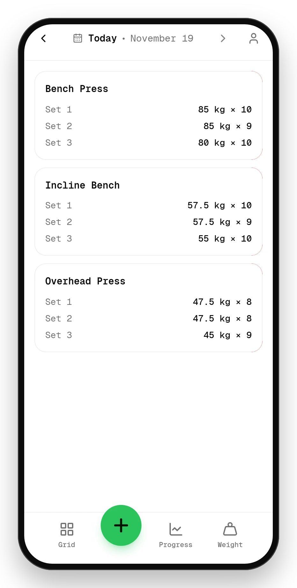<br><sub><b>Daily workout log</b></sub></td>
    <td align="center" width="25%">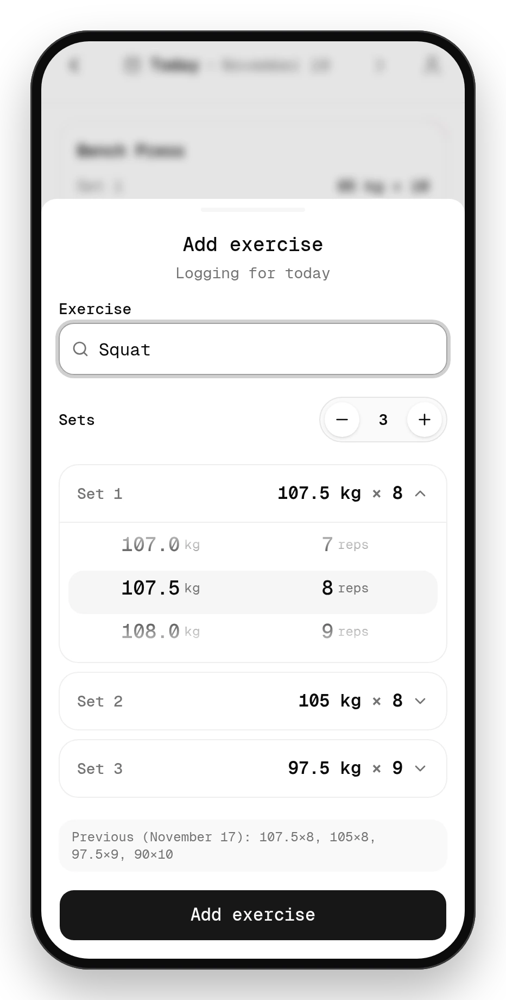<br><sub><b>Scroll-wheel set entry</b></sub></td>
    <td align="center" width="25%">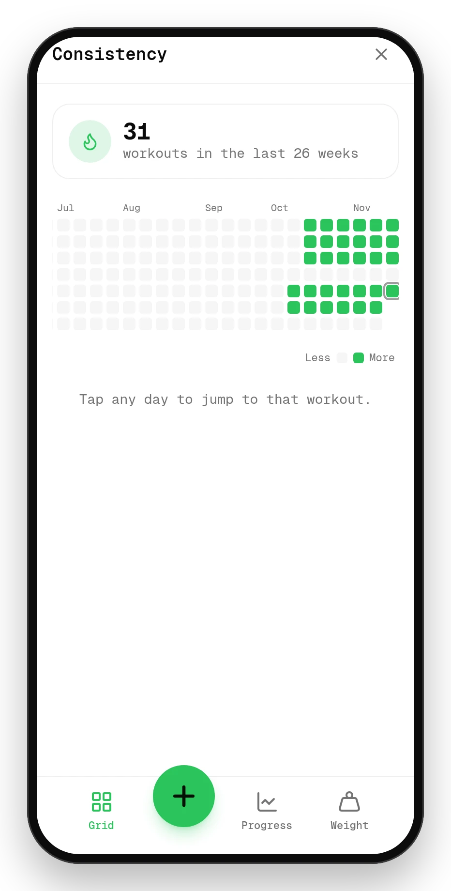<br><sub><b>Consistency heatmap</b></sub></td>
    <td align="center" width="25%">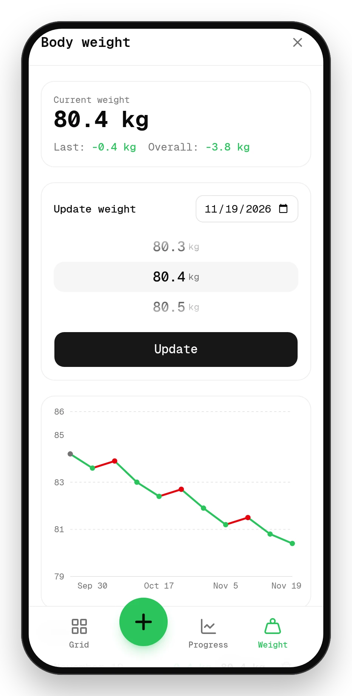<br><sub><b>Body-weight tracker</b></sub></td>
  </tr>
</table>

</div>

---

## Why this exists

Paper notebooks don't chart anything, and most fitness apps are bloated, paywalled or slow. GymGraph is built around one rule: **logging a set should take as few taps as possible, and last session's numbers should always be one glance away.** It's installable on a phone like a native app, works offline, and keeps every person's data private.

## At a glance

| | |
|---|---|
| **What it is** | Installable PWA for strength training: workout log, progress charts, consistency heatmap, body-weight tracking |
| **Users** | Multi-user and invite-only, with each account's data fully isolated |
| **Auth** | Passwordless: authenticator-app codes (TOTP) with single-use recovery codes, implemented from the RFC without an auth library |
| **Stack** | Next.js 16 · React 19 · TypeScript (strict) · Tailwind v4 · Drizzle ORM · Zod · SWR · Zustand · Framer Motion · Recharts |
| **Infra** | Cloudflare Workers (via OpenNext) + Turso (SQLite at the edge), deployed by GitHub Actions on every push to `main` |
| **Cost** | $0/month on the free tiers |

## Features

### Fast logging
- **Scroll-wheel entry.** Weight (0.5 kg steps) and reps are set with iOS-style scroll wheels built on CSS scroll-snap, not a keyboard. For bodyweight moves (pull-ups, dips) the 0 position on the wheel reads **"Body weight"**, and the stats judge those exercises by reps. Every wheel opens **already dialed in to what you lifted last time for that exact set**, so repeating a workout is zero taps and beating it is one scroll.
- **Smart autocomplete** from your own logged history, loaded once and filtered on the device. Find an exercise by its words ("machine overhead") or by its initials ("dmop"); names are normalised so "bench press" and "Bench Press" are the same exercise.
- **Day-by-day log** with arrows and a calendar picker. Each exercise is a card: tap to edit its sets, **swipe left to delete**, with an explicit second-tap confirmation so a stray swipe can't destroy data.

### Progress, at a glance
- **Overall stats** (the Progress tab opens here): your most and least trained exercises, most and least progress (the weekly rate of change of training volume, or reps for bodyweight moves), and your average trained days per month. All computed live from your history.
- **Per-set progress charts** for any exercise: Weight, Reps, Volume, and **Total** (all sets summed per day), one coloured line per set. Charts are lazy-loaded so they never slow first paint.
- **Consistency heatmap**: a GitHub-style grid of the last 26 weeks; tap any day to jump to that workout.
- **Body-weight tracker**: log on a wheel, backfill any date, see the change since your last entry and since you started. **Loss is green, gain is red**, on the numbers, the history and each segment of the chart line.

### Private by design
- **Invite-only** accounts: the admin creates a one-time link, the friend scans a QR code into their authenticator app and receives 8 recovery codes. There is no public sign-up and no password to leak.
- **Installable & offline-capable** PWA with dark mode.

<table>
  <tr>
    <td align="center" width="33%">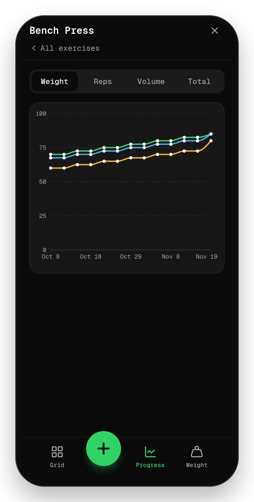<br><sub><b>Per-set progress charts</b><br>(dark mode)</sub></td>
    <td align="center" width="33%">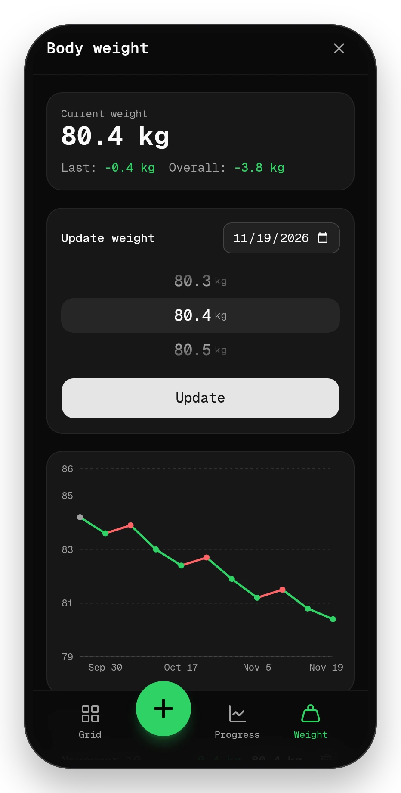<br><sub><b>Green = lost, red = gained</b><br>(dark mode)</sub></td>
    <td align="center" width="33%">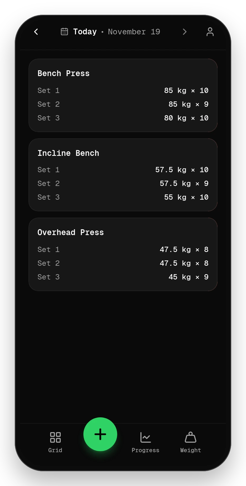<br><sub><b>Dark mode throughout</b><br>follows the system theme</sub></td>
  </tr>
</table>

<table>
  <tr>
    <td align="center" width="33%">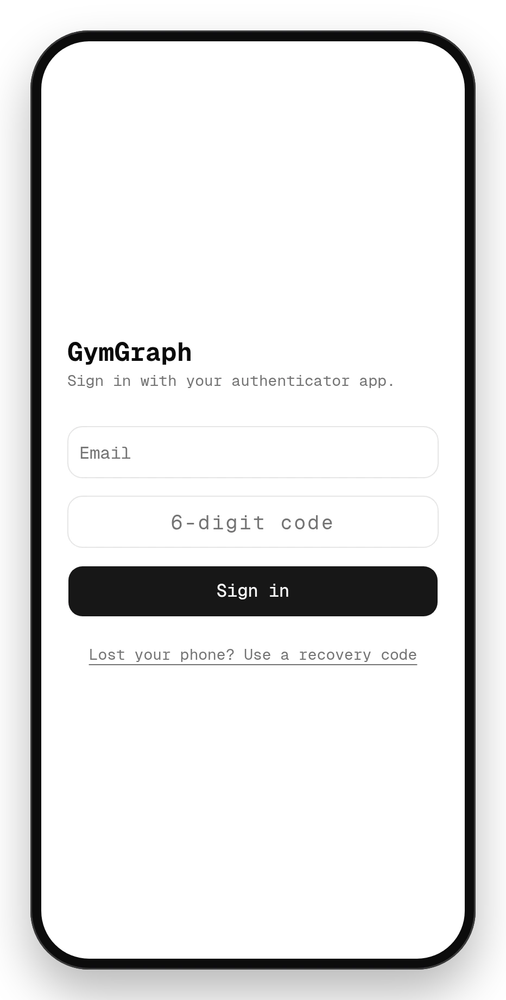<br><sub><b>Passwordless sign-in</b></sub></td>
    <td align="center" width="33%">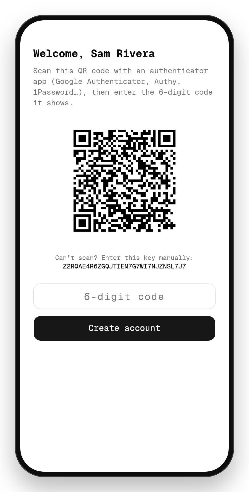<br><sub><b>One-time invite link + QR</b></sub></td>
    <td align="center" width="33%">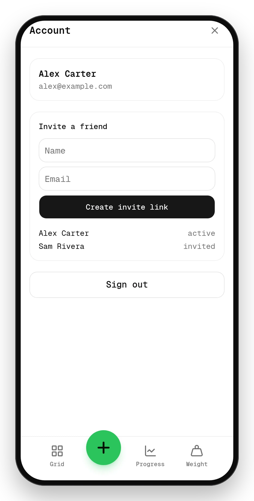<br><sub><b>Admin invites</b></sub></td>
  </tr>
</table>

## Engineering highlights

The parts I'm proudest of, and the decisions behind them:

1. **Passwordless auth built from primitives.** TOTP (RFC 6238) is implemented on the Web Crypto API, so it runs unchanged on Node and in Workers, and is verified against the RFC's published test vectors (`npm run check:totp`). Time steps are claimed **atomically** so a code can't be replayed even by concurrent requests, wrong guesses lock the account for 15 minutes, secrets are **AES-GCM encrypted** at rest, recovery codes are stored **hashed** and are single-use, and sessions are signed, HttpOnly, 30-day cookies. Sign-in answers identically for unknown email and wrong code so accounts can't be probed.
2. **Real multi-tenant isolation.** Every API route requires a session and filters by `user_id`, including nested resources (a workout exercise is owned through its day), and uniqueness is per user (one workout day per user per date, one exercise name per user). Guessing another user's ids returns nothing.
3. **A safe production data migration.** Adding ownership to a live database that already held real data was the riskiest change in the project. I made the migrations idempotent, wrote a backfill script that assigns every existing row to the admin in a single atomic batch, and **rehearsed the whole thing on a snapshot of production**, verifying a content fingerprint of every row was identical before and after, before running it for real.
4. **Serverless on the edge, for free.** Next.js 16 runs on Cloudflare Workers through OpenNext (full Node runtime, no "edge-safe" rewrites), talking to Turso over libSQL. Drizzle was chosen over Prisma precisely because it compiles to plain SQL that works on Workers. A GitHub Actions workflow builds and deploys every push to `main`.
5. **Offline-first PWA without a plugin.** A small hand-written service worker: network-first for pages and API reads with a cache fallback, cache-first for hashed static assets, writes always online. The cached API data is cleared on sign-in and sign-out so one user's data can never show up for another.
6. **Interaction craft.** A custom scroll-snap wheel picker, drag-to-reveal swipe actions (Framer Motion), previous-session seeding, and a chart whose line changes colour per segment using a hard-stop SVG gradient.
7. **Type safety end to end.** TypeScript `strict`; Zod schemas are shared between the client forms and the API routes, and Drizzle gives typed queries from schema to response.

## Architecture

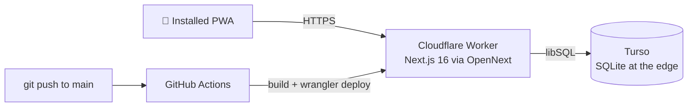

### Data model

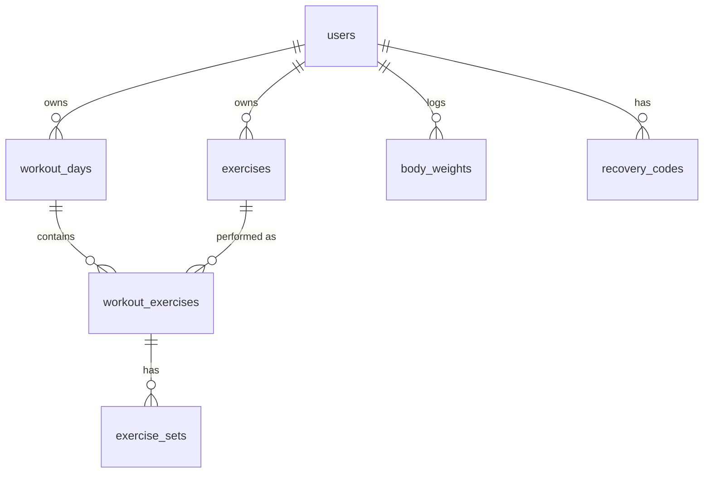

Exercise names live in one `exercises` table per user (matched case-insensitively on create), so a lift logged on different days always resolves to the same exercise for autocomplete and analytics. Foreign keys cascade on delete, and indexes cover every foreign key plus the per-user date and name lookups.

## Tech stack

| Layer | Choice |
|---|---|
| Framework | Next.js 16 (App Router, Turbopack), React 19, TypeScript |
| Styling | Tailwind CSS v4, shadcn/ui on Base UI primitives, Geist Mono |
| Forms & validation | React Hook Form + Zod |
| Data | Drizzle ORM · SQLite locally, [Turso](https://turso.tech) (libSQL) in production |
| Client state | SWR (server cache) + Zustand (UI state) |
| Charts & motion | Recharts (lazy-loaded), Framer Motion |
| Hosting | Cloudflare Workers via [OpenNext](https://opennext.js.org/cloudflare) |
| CI/CD | GitHub Actions |

<details>
<summary><strong>Why these choices over the more obvious defaults</strong></summary>

<br>

- **Drizzle instead of Prisma.** Prisma's query engine is a native binary that doesn't run in Workers without extra infrastructure. Drizzle compiles to plain SQL over the libSQL driver, so identical code runs locally and on Workers.
- **Turso instead of D1.** Turso is libSQL (SQLite's fork), so local development uses a real SQLite file with no emulation layer, and production just points the same client at a remote URL. D1 needs its own bindings and a different local story.
- **OpenNext instead of `@cloudflare/next-on-pages`.** `next-on-pages` restricts routes to the Edge runtime. OpenNext runs standard Next.js (Node runtime, App Router route handlers) on Workers via `nodejs_compat`.
- **TOTP over passwords or magic links.** No passwords to store or leak, and no email service to run or pay for; the trade-off (lost phone) is covered by recovery codes.

</details>

## Run it locally

```bash
npm install
cp .env.example .env                  # defaults work as-is for local development
npm run db:migrate                    # creates local.db from db/migrations
npm run db:seed                       # optional: 6 weeks of sample push/pull/legs data
npm run dev                           # http://localhost:3000, no sign-in needed
```

`npm run dev` signs you in automatically as a local test account (development mode only: production builds always require the authenticator login). To try the real sign-in flow locally, set `DEV_AUTO_LOGIN=off` in `.env` and create an account with `npm run auth:bootstrap -- "Your Name" you@example.com`, which prints a one-time join link.

To use it on your phone during development, connect to the same Wi-Fi and open `http://<your-computer's-LAN-IP>:3000`. `allowedDevOrigins` in `next.config.ts` is pre-configured for common home-network ranges.

<details>
<summary><strong>Scripts</strong></summary>

<br>

| Script | Purpose |
|---|---|
| `npm run dev` | Dev server, bound to `0.0.0.0` so it's reachable on your LAN |
| `npm run build` / `start` | Production build / run |
| `npm run lint` | ESLint |
| `npm run check:totp` | Runs the RFC 6238 test vectors against the TOTP implementation |
| `npm run check:search` | Checks the autofill matching (words and initials) |
| `npm run check:overview` | Checks the Progress > Overall calculations |
| `npm run db:generate` | Generate a migration after editing `db/schema.ts` |
| `npm run db:migrate` | Apply migrations to the database at `DATABASE_URL` |
| `npm run db:studio` | Drizzle Studio (visual DB browser) |
| `npm run db:seed` | Wipe and reseed sample data (attached to the first user) |
| `npm run auth:bootstrap` | Create the admin account and assign all existing data to it |
| `npm run cf:preview` | Build with OpenNext and run locally under `wrangler` |
| `npm run cf:deploy` | Build and deploy to Cloudflare Workers manually |

</details>

<details>
<summary><strong>Environment variables</strong></summary>

<br>

| Variable | Local default | Production |
|---|---|---|
| `DATABASE_URL` | `file:./local.db` | Turso URL, e.g. `libsql://<db>-<org>.turso.io` |
| `DATABASE_AUTH_TOKEN` | not needed | Turso database token |
| `AUTH_SECRET` | any 16+ char string (`openssl rand -base64 32`) | Worker secret; must match the value used when running `auth:bootstrap` against prod |
| `DEV_AUTO_LOGIN` | unset: `next dev` signs you in as a test account; `off` requires the real login | ignored: production always requires login |

Keep `AUTH_SECRET` stable: changing it signs everyone out and makes stored TOTP secrets undecryptable.

</details>

<details>
<summary><strong>Accounts and security details</strong></summary>

<br>

- **Invite-only.** The admin creates an invite (name + email) on the Account page and sends the one-time link (valid 7 days) privately. The invitee scans a QR code into an authenticator app, confirms one code, and receives 8 single-use recovery codes.
- **Login** is email plus a 6-digit code, or a recovery code.
- **Protections:** a code can't be reused within its time window, 5 wrong attempts lock the account for 15 minutes, TOTP secrets are AES-GCM encrypted with a key derived from `AUTH_SECRET`, and every API route checks the session and filters by `user_id`.
- **Bootstrapping or upgrading a database:** `npm run auth:bootstrap -- "Full Name" you@example.com` creates the admin, assigns every existing row to that account, and prints the join link. It refuses to run if an account already exists.

</details>

<details>
<summary><strong>Deploy your own copy to Cloudflare (free tier)</strong></summary>

<br>

**1. Create the production database (Turso)**

```bash
curl -sSfL https://get.tur.so/install.sh | bash
turso auth login
turso db create gymgraph
turso db show gymgraph --url          # → DATABASE_URL
turso db tokens create gymgraph       # → DATABASE_AUTH_TOKEN
DATABASE_URL="libsql://..." DATABASE_AUTH_TOKEN="..." npm run db:migrate
```

**2. Configure Cloudflare secrets**

```bash
npx wrangler login
npx wrangler secret put DATABASE_URL
npx wrangler secret put DATABASE_AUTH_TOKEN
export AUTH_SECRET=$(openssl rand -base64 32)      # keep this exact value for the bootstrap step
echo -n "$AUTH_SECRET" | npx wrangler secret put AUTH_SECRET
```

`auth:bootstrap` encrypts the admin's authenticator secret with `AUTH_SECRET` and the Worker decrypts it with its own copy, so both must match. Run the bootstrap in the same terminal, then `unset AUTH_SECRET`, and save the value in a password manager (a Worker secret can't be read back). `wrangler.jsonc` already declares the Worker, the assets binding and `nodejs_compat`.

**3. Create the admin and deploy**

```bash
APP_URL="https://your-domain" DATABASE_URL="libsql://..." DATABASE_AUTH_TOKEN="..." \
  npm run auth:bootstrap -- "Your Name" you@example.com     # prints your join link
npm run cf:deploy
```

**4. Auto-deploy on every push to `main`**

Create a Cloudflare API token (**My Profile → API Tokens → Edit Cloudflare Workers** template) and add it to the repo as the secret `CLOUDFLARE_API_TOKEN`. From then on `.github/workflows/deploy.yml` ships every push. Database secrets never touch GitHub; they live on the Worker.

**5. Custom domain** (declared in `wrangler.jsonc`, so it's re-applied on every deploy)

```jsonc
"routes": [{ "pattern": "gym.yourdomain.com", "custom_domain": true }]
```

**6. Install on your phone:** iOS Safari → Share → *Add to Home Screen*; Android Chrome → ⋮ → *Install app*.

</details>

<details>
<summary><strong>Project structure</strong></summary>

<br>

```
app/
  page.tsx                  Home: the selected day's workout
  progress/                 Consistency heatmap
  analytics/                Exercise search + per-set progress charts
  weight/                   Body-weight tracker
  login/  join/  account/   Sign-in, invite acceptance (QR), account + admin invites
  manifest.ts               PWA manifest
  api/
    workout/                          GET  a day's workout
    workout-exercises/ (+[id])        POST create · PATCH edit sets · DELETE
    exercises/ (+previous)            GET  autocomplete · last session's sets
    contributions/                    GET  trained dates (heatmap)
    analytics/{exercises,data,overview}/   GET  exercise list · time series · Overall stats
    body-weight/                      GET · POST (upsert per day) · DELETE
    auth/{login,logout,me,join,invite}/
components/
  add-exercise/   add/edit sheet, autocomplete, wheel picker
  home/           exercise card with swipe-to-delete
  analytics/      search list, metric tabs, chart
  progress/       contribution grid
  weight/         weight chart + colour helpers
  layout/         top bar, bottom nav, app shell, service-worker registration
  ui/             shadcn/ui primitives in use
db/               Drizzle schema, client, migrations, seed, bootstrap-admin script
lib/
  auth/           totp · crypto (AES-GCM, HMAC sessions) · session · invite
  store/          Zustand store    api.ts   typed fetch wrappers
  exercise-search.ts   autofill matching: words + initials
  overview.ts          Progress > Overall statistics (pure, unit-checked)
  validation.ts   Zod schemas shared by client and API
public/sw.js      hand-written service worker
.github/workflows/deploy.yml
```

</details>

## PWA and offline behaviour

`public/sw.js` is registered only in production:

- **Pages (HTML)**: network-first with a cached-shell fallback, so the app still opens offline.
- **`/api/*` reads**: network-first with a cache fallback, so recently loaded data is available offline. Writes (`POST`/`PATCH`/`DELETE`) always go straight to the network.
- **`_next/static/*` and icons**: cache-first, since they're content-hashed.
- The API cache is cleared on sign-in and sign-out.

## License

[MIT](LICENSE)
